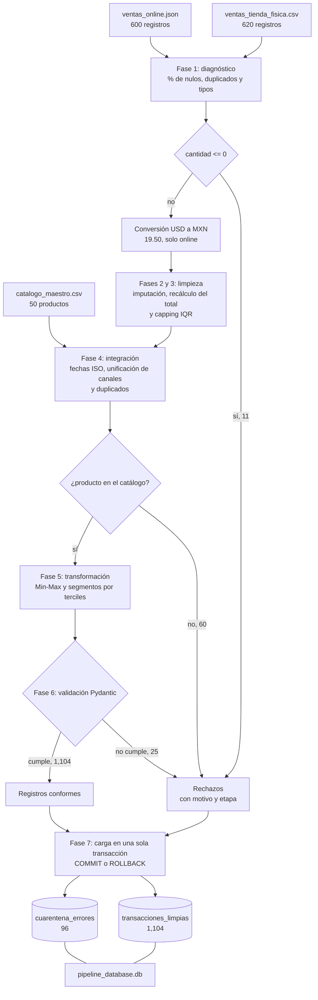

# Reglas de negocio del pipeline ETL

Pipeline ETL para la cadena Retail & E-commerce Omnicanal. Integra las ventas de tienda física y de la tienda web en una base SQLite, después de diagnosticar, limpiar, unificar, transformar y validar los datos. Los registros que no cumplen las reglas no se pierden: quedan en una tabla de cuarentena con el motivo del rechazo.

| Rol | Fases | Módulos |
|---|---|---|
| Ingeniero/a 1: calidad, nulos y outliers | 1, 2 y 3 | `diagnostico.py`, `limpieza.py` |
| Ingeniero/a 2: transformación e integración | 4 y 5 | `integracion.py`, `transformacion.py` |
| Ingeniero/a 3: validación, resiliencia y base de datos | 6 y 7 | `schemas.py`, `database.py` |
| Equipo | Orquestación y pruebas | `main.py`, `tests/test_estres.py` |

## 1. Fuentes y problemas detectados

| Fuente | Registros | Problemas |
|---|---:|---|
| `catalogo_productos.csv` | 50 | Ninguno. Es el catálogo maestro (PROD-001 a PROD-050). |
| `ventas_tienda_fisica.csv` | 620 | 20 tickets duplicados del POS, fechas en tres formatos (`2026-09-13`, `13/09/2026`, `13-09-2026`), 32 totales nulos, 127 clientes nulos, cantidades de 0, -1, 99 y 500, métodos de pago con mayúsculas distintas (`Efectivo` y `efectivo`). |
| `ventas_online.json` | 600 | Fechas en ISO mezcladas con timestamps Unix, 193 órdenes en USD, 20 correos ausentes y 28 malformados (`correo_invalido.com`, `usuario@@gmail..com`), totales inflados de bots (WEB-00508: 3 piezas de $3,443.17 con total de $826,360.80), estados con mayúsculas distintas. |

Entre las dos fuentes de ventas hay 62 transacciones con productos que no existen en el catálogo (PROD-8xx y PROD-9xx): 29 de tienda física y 33 online. Después de quitar duplicados y cantidades imposibles quedan 60.

## 2. Diagrama de flujo



Los 20 duplicados del POS se eliminan en la fase 4 y no pasan a cuarentena, porque son reintentos del mismo ticket y su primera copia sí se conserva.

## 3. Fase 1: diagnóstico de calidad

`perfilado_inicial()` mide sobre los datos crudos, sin modificarlos, el porcentaje de nulos por columna, los duplicados exactos y el tipo inferido de cada columna.

| Fuente | Columna | Nulos | % |
|---|---|---:|---:|
| Tienda física | `monto_total_mxn` | 32 | 5.2 |
| Tienda física | `id_cliente` | 127 | 20.5 |
| Online | `customer_email` | 15 (más 5 cadenas vacías) | 2.5 |
| Online | `shipping_address` | 77 | 12.8 |

Duplicados exactos: 20 en tienda física y 0 en online. Además, en el JSON la columna `order_timestamp` tiene tipo mixto (texto y entero), lo que confirma que hay dos formatos de fecha en la misma columna.

## 4. Fases 2 y 3: faltantes y outliers

### Clasificación de las ausencias

Para saber si los nulos dependen de otra variable se cruzó cada indicador de nulo contra las columnas categóricas de su fuente con una prueba chi-cuadrada de independencia, y contra cantidad y precio con una prueba de Mann-Whitney. Las pruebas se hicieron sobre los datos crudos, con el método de pago y el estado de la orden pasados a mayúsculas para no separar `efectivo` de `Efectivo`. En `customer_email` se cuentan como ausentes los 15 nulos y las 5 cadenas vacías.

| Columna con nulos | Comparada contra | p-valor | Clasificación |
|---|---|---:|---|
| `id_cliente` | sucursal | 0.714 | MCAR |
| | método de pago | 0.571 | |
| | cantidad / precio | 0.387 / 0.080 | |
| `monto_total_mxn` | sucursal | 0.479 | MCAR, recuperable |
| | método de pago | 0.568 | |
| `customer_email` | pasarela | 0.779 | MCAR |
| | estado de la orden | 0.949 | |
| | moneda | 0.314 | |
| `shipping_address` | pasarela | 0.532 | MCAR |
| | estado de la orden | 0.280 | |
| | moneda | 0.944 | |

Ningún p-valor baja de 0.05, así que no hay evidencia de que la ausencia dependa de las variables observadas, y se trata como MCAR. La prueba no descarta una dependencia con algo que no está en los datos, como que el cajero olvide pedir el número de cliente, pero con la información disponible no hay un patrón que corregir. Para estas columnas la imputación con una etiqueta fija no introduce sesgo.

El total nulo de tienda física es un caso aparte: aunque sea MCAR, el valor se puede recuperar exactamente con `cantidad × precio_unitario`, que nunca son nulos. Por eso no se imputa con un estadístico.

### Imputación

| Tipo de columna | Regla |
|---|---|
| Numérica | Mediana de la columna |
| Categórica | Etiqueta `ANONIMO` |
| `monto_total` | Siempre se recalcula como `cantidad × precio`, haya o no nulo |

Se usa la mediana y no la media porque las variables numéricas están muy sesgadas a la derecha. La asimetría se midió con el coeficiente de Fisher-Pearson sin corrección por tamaño de muestra (`scipy.stats.skew`); con `pandas.Series.skew()`, que sí la corrige, los valores de cantidad y monto suben en la segunda decimal y el del precio no cambia.

| Variable | Asimetría | Media | Mediana |
|---|---:|---:|---:|
| Cantidad, tienda física | 9.45 | 8.42 | 2 |
| Monto total, tienda física | 14.04 | 16,586.74 | 3,506.37 |
| Monto total online (MXN) | 16.05 | 6,942.27 | 2,514.95 |
| Precio unitario, tienda física | 0.43 | 1,992.59 | 1,630.95 |

En tienda física, la media de la cantidad es 8.42 porque unos pocos tickets de 99 y 500 piezas la arrastran, mientras que la venta típica es de 2. Imputar con la media metería compras irreales en los huecos. La mediana no se mueve con esos extremos.

En los datos actuales cantidad y precio no tienen nulos, así que la imputación por mediana no se aplicó a ninguna celda. La regla queda en el código para lotes futuros. Con `ANONIMO` se imputaron 127 clientes en tienda física y 92 valores en online (correos y direcciones).

### Outliers con IQR

Para cada columna numérica se calcula IQR = Q3 − Q1 y los límites Q1 − 1.5·IQR y Q3 + 1.5·IQR. Los valores fuera de los límites se recortan al límite (capping), sin eliminar la fila.

| Columna | Q1 | Q3 | Límites | Celdas recortadas |
|---|---:|---:|---|---:|
| Cantidad, tienda física | 1 | 4 | [−3.50, 8.50] | 13 |
| Precio, tienda física | 1,025.98 | 2,966.70 | [−1,885.10, 5,877.78] | 0 |
| Cantidad, online | 1 | 2 | [−0.50, 3.50] | 0 |
| Precio, online | 1,008.15 | 2,985.84 | [−1,958.38, 5,952.38] | 0 |

Las 13 cantidades recortadas son tickets de bots o errores de captura: 7 de 99 piezas y 6 de 500. Después del capping la cantidad se redondea hacia abajo y queda en 8: redondear hacia arriba la dejaría en 9, por encima del límite, y una cantidad de 8.5 piezas no existe.

El total no se recorta por separado. Se recalcula después del capping, para que siempre cumpla `monto_total = cantidad × precio`. Así se corrigen también los totales inflados de los bots online, como WEB-00508.

Las ventas online se convierten a MXN antes del capping. Si no, el IQR del precio mezclaría importes en pesos y en dólares, y los precios en dólares (17 a 216) se verían como valores bajos normales.

### Valores imposibles

Solo se eliminan las filas con cantidad ≤ 0 (11 en tienda física), porque no representan una venta. Antes de la limpieza se separan y se guardan en cuarentena con la etapa `limpieza` y el motivo `cantidad <= 0: valor imposible`, para que el descarte quede registrado.

## 5. Fase 4: integración

### Fechas

Todas las fechas se llevan a ISO (`AAAA-MM-DD`). `unificar_fechas()` reconoce ISO, ISO con hora, `DD-MM-AAAA`, `DD/MM/AAAA` y timestamps Unix en segundos (UTC). Cuando el día va primero se interpreta como día/mes, que es la convención en México: `03-09-2026` es el 3 de septiembre. Con los datos actuales no quedó ninguna fecha ilegible.

### Divisas

Las 193 órdenes en USD se convierten a MXN con la paridad oficial del proyecto, `TIPO_CAMBIO_USD_MXN = 19.50`, en precio y total, redondeando a dos decimales. La conversión se hace antes de la limpieza, por el motivo explicado en la fase 3.

### Unificación de canales

Las dos fuentes se llevan a un esquema común (`COLUMNAS_UNIFICADAS`) con la columna `canal` en `FISICA` u `ONLINE`. Los campos que no existen en un canal se llenan con `NO_APLICA`: por ejemplo, el correo y la pasarela en tienda física, o la sucursal y el método de pago en online. Se usa una etiqueta distinta de `ANONIMO` para diferenciar "no aplica a este canal" de "el dato faltaba". El método de pago se normaliza a formato título y el estado de la orden a mayúsculas.

### Duplicados

Se eliminan los registros con el mismo `id_transaccion` y se conserva la primera aparición. Son 20 reintentos del POS: el mismo ticket con los mismos datos, enviado dos veces.

### Productos huérfanos

Cada venta se cruza con el catálogo maestro mediante un left join. Las 60 ventas cuyo producto no existe se marcan con `es_huerfano` y se separan a cuarentena con la etapa `integracion`. Sin producto no hay categoría, proveedor ni precio base, así que no sirven para análisis.

## 6. Fase 5: transformación

### Escalamiento Min-Max

```
monto_total_norm = (monto_total − min) / (max − min)
```

Se calcula sobre los 1,129 registros que salen de la fase 4. Con los datos actuales el mínimo es 332.67 MXN y el máximo 33,744.88 MXN. Si todos los montos fueran iguales, el resultado sería 0 para evitar la división entre cero.

### Segmentos de monto

El importe se divide en Bajo, Medio y Alto por terciles (cuantiles 1/3 y 2/3), que se recalculan en cada ejecución:

| Segmento | Rango con los datos actuales |
|---|---|
| Bajo | hasta 2,069.07 MXN |
| Medio | más de 2,069.07 y hasta 4,183.67 MXN |
| Alto | más de 4,183.67 MXN |

Se eligieron terciles porque el proyecto no define umbrales comerciales, y así cada segmento queda con un tercio de las ventas (380, 374 y 375 a la salida de la fase 5). `discretizar_monto()` acepta umbrales fijos (`umbrales=(a, b)`) si el negocio los define después.

## 7. Fase 6: validación con Pydantic

Cada registro se valida contra el modelo `TransaccionLimpia` (`BaseModel` con `@field_validator` y `@model_validator`). Pydantic reúne todos los errores de un registro, así que un rechazo puede tener varios motivos separados por `|`.

| Regla | Justificación |
|---|---|
| `id_transaccion` con formato `POS-AAAA-NNNN` o `WEB-NNNNN`, y con el prefijo de su canal | Un `POS-` marcado como ONLINE indica fuentes mezcladas. |
| `canal` reconocido | Solo existen tienda física y online. |
| `fecha` en `AAAA-MM-DD`, existente y entre 2020-01-01 y hoy | Detecta cualquier fecha que no se haya homologado, como un 30 de febrero o un timestamp. |
| `id_producto` con formato `PROD-NNN` y presente en el catálogo | Segunda revisión de huérfanos. |
| `cantidad` entera, mayor que 0 y como máximo 100 | Cero o negativo no es una venta. Más de 100 piezas del mismo artículo no corresponde al menudeo. |
| `precio_unitario_mxn` y `monto_total_mxn` positivos y finitos | En los crudos hay montos negativos y nulos. |
| `monto_total_mxn` igual a `cantidad × precio_unitario_mxn`, con 1 % de tolerancia | Detecta totales inflados de bots si alguno no se recalculó. El 1 % cubre el redondeo de la conversión de divisas. |
| `moneda` igual a MXN | Evita guardar dólares como pesos. |
| `correo_cliente` vacío, etiqueta controlada (`ANONIMO`, `NO_APLICA`) o con formato válido | Una ausencia es legítima. Un correo como `usuario@@gmail..com` es un dato corrupto. |
| `sucursal` obligatoria en tienda física | Una venta física sin sucursal no se puede asignar a una tienda. |
| `monto_normalizado` entre 0 y 1, y `segmento_monto` en Bajo/Medio/Alto | Confirma que la fase 5 se aplicó. |
| `clabe` de 18 dígitos con dígito verificador correcto | Los datos actuales no traen CLABE. El validador revisa el dígito con los pesos 3, 7 y 1. |
| `id_transaccion` sin repetirse en el lote | Protege la llave primaria de la base. |

El modelo también normaliza valores: métodos de pago con mayúscula inicial, estados en mayúsculas y canales a `TIENDA_FISICA` u `ONLINE`. Las ventas canceladas o devueltas no se rechazan, porque son transacciones reales.

Con los datos actuales se rechazaron 25 registros, todos por correo malformado. Los bots y las cantidades extremas ya llegan corregidos desde la fase 3, y la regla de consistencia queda como segunda barrera.

### Cuarentena sin detener el lote

`validar_lote()` valida cada registro dentro de un bloque `try ... except ValidationError`. Hay un segundo `except Exception` para errores que no vienen de Pydantic, y una revisión previa para filas que ni siquiera son diccionarios. En cualquier caso la fila va a cuarentena con su motivo y el ciclo continúa. Cada rechazo guarda el id, el canal, la etapa, los campos con error, el motivo en `motivo_rechazo_cuarentena` y el registro original completo en JSON, para revisarlo o reprocesarlo.

## 8. Fase 7: carga transaccional

La base es SQLite y se maneja con el módulo estándar `sqlite3` en modo de transacciones manuales (`isolation_level=None`). Cada `BEGIN`, `COMMIT` y `ROLLBACK` está escrito en el código.

| Tabla | Contenido |
|---|---|
| `transacciones_limpias` | Registros validados. Llave primaria `id_transaccion` y restricciones `CHECK`: cantidad > 0, montos > 0, moneda = 'MXN', fecha con forma ISO, segmento válido y normalizado entre 0 y 1. |
| `cuarentena_errores` | Registros rechazados en limpieza, integración o validación, con su motivo. |
| `bitacora_cargas` | Una fila por ejecución: inicio, fin, filas cargadas y si terminó en COMMIT o ROLLBACK. |
| `catalogo_productos` | Copia del catálogo maestro, para cruzar ventas con categoría y proveedor. |

Las restricciones `CHECK` repiten algunas reglas de Pydantic a propósito: si alguien inserta datos por fuera del pipeline, la base los rechaza igual.

`transacciones_limpias` y `cuarentena_errores` se escriben en una sola transacción. Si cualquier inserción falla, por una llave repetida o un valor que viola un `CHECK`, se ejecuta `ROLLBACK` y la base queda como estaba antes de la carga. La bitácora se escribe fuera de esa transacción, así el intento fallido queda registrado con su mensaje de error.

En cada ejecución las tablas se eliminan y se vuelven a crear dentro de la misma transacción. Correr el pipeline dos veces deja la misma base, sin duplicados, y una base creada con un esquema anterior se actualiza sola. La bitácora nunca se borra.

## 9. Resiliencia

`main.py` ejecuta cada fase dentro de una función que captura cualquier excepción y la convierte en un error con el nombre de la fase. Si algo falla, el programa indica qué fase falló y por qué, y termina con código de salida 1 sin mostrar un traceback. Si la carga termina en ROLLBACK, también se reporta como fallo.

`tests/test_estres.py` tiene 54 pruebas, entre ellas:

- cada regla de validación con un valor que la rompe, y varios errores en un mismo registro;
- lotes con `None`, números, textos sueltos y diccionarios vacíos mezclados con registros válidos;
- 20,000 registros con 30 % de errores aleatorios, verificando que limpios más cuarentena suman el total;
- rollback cuando una fila viola un `CHECK` a la mitad del lote y cuando se repite una llave primaria;
- una base con un esquema anterior, que se actualiza y termina en COMMIT;
- una ruta de base inválida, que devuelve ROLLBACK con el error en vez de detener el programa.

## 10. Resultado

| Etapa | Registros |
|---|---:|
| Leídos (620 de tienda física y 600 online) | 1,220 |
| Cantidades imposibles a cuarentena | −11 |
| Salida de la limpieza | 1,209 |
| Duplicados del POS eliminados | −20 |
| Huérfanos a cuarentena | −60 |
| Salida de la integración y la transformación | 1,129 |
| Rechazados por validación | −25 |
| Transacciones limpias en la base | 1,104 |

En la base quedan 1,104 transacciones limpias (562 de tienda física y 542 online), por un total de 4,927,109.37 MXN, y 96 registros en cuarentena (11 de limpieza, 60 de integración y 25 de validación). Los 1,220 registros leídos están todos contados: 1,104 limpios, 96 en cuarentena y 20 duplicados eliminados.

## Ejecución

```
cd proyecto-etl-equipo
pip install -r requirements.txt
python main.py
pytest -v tests/test_estres.py
```
